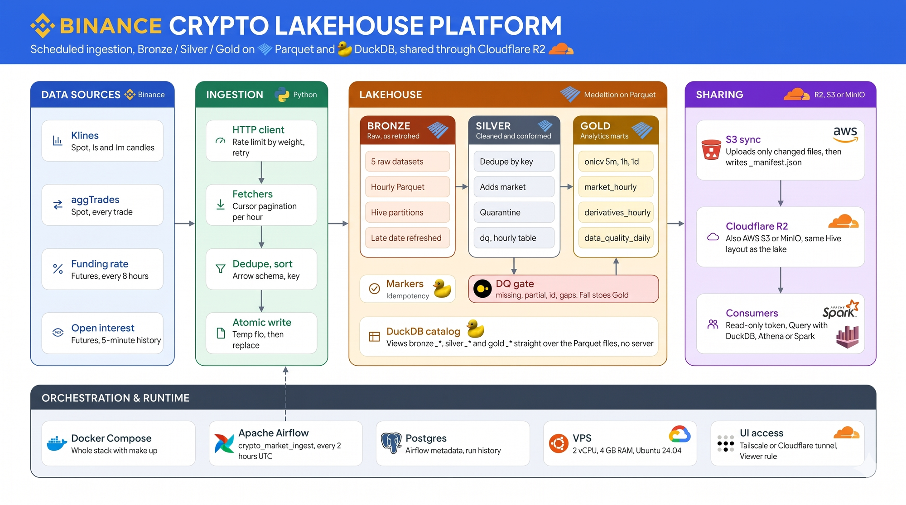

# Binance Crypto Data Platform

Pipeline thu thập dữ liệu thị trường crypto tần suất cao từ **Binance public API**,
chạy **Airflow mỗi 2 giờ**, lưu thành **Parquet lake** partition theo giờ, query bằng
**DuckDB** và publish lên **Cloudflare R2 / S3 / MinIO** để chia sẻ.



> **MFF4030 group 4:** phân tích chất lượng thị trường trên lake → thư mục [`B4_as_requested/`](B4_as_requested/).

<details>
<summary>Sơ đồ dạng text (cho terminal / diff)</summary>

```
Binance REST API
      │  (klines 1s/1m, aggTrades, funding rate, open interest)
      ▼
crypto_ingest (rate limit + retry + pagination)
      │
      ▼
data/lake/exchange=binance/dataset=.../symbol=.../date=.../hour=.../part-00000.parquet
      │
      ├── data/_state/completed/...   (marker idempotency)
      └── data/catalog.duckdb         (DuckDB views)
                │
                ├──► SQL / notebook / dashboard
                └──► S3 / R2 / MinIO (chia sẻ cho người khác)
```

</details>

## Triển khai hiện tại

Repo này được thiết kế để chạy cả local và trên VPS:

- **Airflow + Docker Compose** chạy 24/7 trên VPS 2 vCPU / 4 GB RAM
  (ví dụ GCP `e2-medium`, Singapore, Ubuntu 24.04 LTS).
- **DAG** `crypto_market_ingest`, schedule `0 */2 * * *` UTC.
- **UI** có thể truy cập qua LAN, Cloudflare Tunnel hoặc Tailscale Funnel.
- **Dữ liệu** được publish incrementally lên R2 kèm `_manifest.json`.
- Tài khoản `Viewer` chỉ được xem DAG/log, không trigger hay sửa.

## Vì sao thiết kế như vậy

- **Mỗi giờ = một file Parquet** → ghi atomic, retry/backfill chỉ ghi đè đúng giờ đó,
  không sinh dữ liệu trùng hoặc file dở dang.
- **Marker hoàn thành theo từng partition** → chạy lại cùng window gần như miễn phí;
  task fail thì lần retry chỉ tải lại phần thiếu.
- **Rate limit + retry** nằm trong code, không phụ thuộc Airflow.
- **DuckDB** đọc trực tiếp Parquet, không cần server, không copy dữ liệu.
- **Upload incremental** dựa trên ETag/MD5, chỉ đẩy file mới hoặc thay đổi.

## Dataset

| Dataset | Nguồn | Tần suất | Ghi chú |
|---|---|---|---|
| `klines_1s` | `GET /api/v3/klines` | 1 giây | ~3.600 dòng/giờ/symbol |
| `klines_1m` | `GET /api/v3/klines` | 1 phút | ~60 dòng/giờ/symbol |
| `agg_trades` | `GET /api/v3/aggTrades` | từng trade | Nặng nhất, phân trang theo `fromId` |
| `funding_rate` | `GET /fapi/v1/fundingRate` | 8 giờ/lần | Futures |
| `open_interest` | `GET /futures/data/openInterestHist` | 5 phút | Chỉ lấy được 30 ngày gần nhất |

## Quickstart (không cần Airflow)

Yêu cầu: Python >= 3.10.

```bash
git clone https://github.com/HaiHuynh206/binance-crypto-automation-analysis.git
cd binance-crypto-automation-analysis

make install

# Lấy 2 giờ gần nhất cho toàn bộ dataset mặc định
.venv/bin/crypto-ingest ingest --hours 2

# Chỉ lấy nến 1 phút trong 1 ngày
.venv/bin/crypto-ingest ingest -d klines_1m \
  --start 2026-10-20T00:00:00Z --end 2026-10-21T00:00:00Z

# Xem dung lượng / độ phủ
.venv/bin/crypto-ingest status

# Tạo view DuckDB rồi query
.venv/bin/crypto-ingest catalog
.venv/bin/python -c "
import duckdb
con = duckdb.connect('data/catalog.duckdb', read_only=True)
print(con.sql('''
    SELECT symbol, count(*) rows, min(open_time), max(open_time)
    FROM klines_1m GROUP BY 1 ORDER BY 1
'''))
# Silver/Gold: view gold_ohlcv, gold_market_hourly, silver_trades... (xem docs/consumer.md)
"

# Backfill 7 ngày
.venv/bin/crypto-ingest backfill --days 7 -d klines_1m,agg_trades

# Upload lên R2/S3/MinIO (cấu hình .env trước, xem docs/share-s3.md)
.venv/bin/crypto-ingest sync-s3 --dry-run
```

> Lần chạy đầu với `agg_trades` cho BTCUSDT có thể mất vài phút vì phải phân trang
> qua hàng trăm nghìn trade. Bắt đầu với `-d klines_1m` để test nhanh.

## Chạy Airflow bằng Docker

Cài Docker (Ubuntu/Debian, cần quyền sudo):

```bash
sudo bash scripts/install-docker.sh
# đăng xuất/đăng nhập lại để dùng docker không cần sudo
```

Tạo file cấu hình và khởi động:

```bash
cp .env.example .env
# sửa tối thiểu: AIRFLOW_ADMIN_PASSWORD, CRYPTO_S3_* nếu dùng R2/S3
make up
```

- UI: `http://localhost:8080`
- DAG: `crypto_market_ingest`, schedule `0 */2 * * *` UTC.
- Mở UI và bật DAG (lúc tạo đang **paused**).
- Logs: `make logs`; dừng: `make down`; reset toàn bộ:
  `make down && docker compose down -v`.

Lưu ý:

- **Giữ `AIRFLOW_UID=50000`** trong `.env`. Nếu đổi thành UID của bạn (1000),
  Airflow có thể báo lỗi `The user that Airflow is running as has no username`.
- Nếu vừa cài Docker mà gặp `permission denied`, logout/login hoặc chạy
  `newgrp docker`.
- Chạy CLI trên host **và** Airflow trong container cùng lúc thì cần quyền ghi chung
  cho `data/`: `make permissions`.
- Đổi `CRYPTO_SYMBOLS`/`CRYPTO_DATASETS` trong `.env` rồi
  `docker compose up -d` để áp dụng.

Luồng task (3 task group):

```
bronze/ingest_* (5 task)
      └─► silver_gold/build_silver_layer ─► silver_gold/dq_check ─► silver_gold/build_gold_layer
                                                                          ├─► serve/refresh_catalog
                                                                          └─► serve/publish_to_s3
```

Tên task trong Airflow có tiền tố group (`bronze.ingest_klines_1m`,
`silver_gold.dq_check`, `serve.publish_to_s3`); task_id bên trong group giữ nguyên
như trước khi refactor.

`dq_check` là cổng chất lượng: fail thì Gold không được dựng, catalog vẫn refresh,
và S3 chỉ đẩy Bronze (Silver/Gold bị bỏ qua). Đặt `CRYPTO_MEDALLION_ENABLED=0` để
tạm quay lại luồng chỉ có Bronze: DAG chỉ còn group `bronze` và `serve`
(`build_silver_layer`/`dq_check`/`build_gold_layer` không được tạo). Chi tiết
Bronze/Silver/Gold ở [docs/medallion.md](docs/medallion.md).

`max_active_tasks=2` để tránh 5 task cùng đập vào rate limit của Binance.

## Chạy 24/7 trên VPS

Yêu cầu tối thiểu: **2 vCPU, 4 GB RAM, 40 GB SSD**, Ubuntu 24.04 LTS.
Nên thêm 2 GB swap. VPS 2 GB RAM dễ OOM khi Airflow + Postgres + ingest chạy cùng.

Migrate code và dữ liệu từ máy local:

```bash
make migrate HOST=user@<IP> WITH_DATA=1
```

Sau khi migrate:

1. Đặt `AIRFLOW_WEB_BIND=127.0.0.1` trong `.env` nếu chỉ truy cập qua tunnel.
2. Kiểm tra `docker compose ps` và `curl localhost:8080/health`.
3. Dừng stack local (`make down`, `make unshare`) để tránh hai DAG cùng chạy.
4. Cập nhật link UI cho người nhận.

Chi tiết chọn VPS, firewall, backup và migrate dữ liệu:
[`docs/deploy-vps.md`](docs/deploy-vps.md).

## Chia sẻ dữ liệu

Đẩy lake lên **Cloudflare R2 / AWS S3 / MinIO**, giữ nguyên layout Hive để người
nhận query bằng DuckDB, Athena hoặc Spark:

```bash
make sync-s3 DRY_RUN=1   # xem trước
make sync-s3             # upload phần thay đổi + _manifest.json
```

DAG tự chạy task `serve.publish_to_s3` sau mỗi lần ingest khi `CRYPTO_S3_BUCKET` được set.

- Người nhận chỉ cần **read-only token**, không cấp write token.
- Manifest nằm tại `s3://<bucket>/<prefix>/_manifest.json`.
- Hướng dẫn tạo bucket R2, cấp quyền đọc, query mẫu và chi phí:
  [`docs/share-s3.md`](docs/share-s3.md).
- Hướng dẫn gửi cho người nhận (chọn tầng Bronze/Silver/Gold, công thức query, lưu ý múi giờ
  và partition): [`docs/consumer.md`](docs/consumer.md).

## Chia sẻ UI

### Cùng LAN

Mở `http://<ip-may-chay-airflow>:8080`. Chỉ nên dùng trong mạng tin cậy.

### Cloudflare Quick Tunnel — nhanh, URL tạm

```bash
make share      # in ra https://<random>.trycloudflare.com
make unshare    # dừng tunnel
```

URL **đổi sau mỗi lần restart**, phù hợp demo ngắn.

### Tailscale Funnel — URL cố định, không cần domain

Cài Tailscale trên máy chạy Airflow:

```bash
curl -fsSL https://tailscale.com/install.sh | sh
sudo tailscale up --hostname=airflow-crypto --accept-dns=false
sudo tailscale funnel --bg 8080
```

Lần đầu cần bật Funnel cho tailnet theo hướng dẫn của Tailscale. URL có dạng:

```text
https://airflow-crypto.<tailnet>.ts.net
```

URL giữ nguyên khi reboot, miễn là Tailscale và Funnel còn bật.

### Named Tunnel + domain — ổn định lâu dài

Nếu có domain trên Cloudflare, dùng Named Tunnel để có URL như
`https://airflow.example.com`. Chi tiết:
[`docs/sharing.md`](docs/sharing.md).

### Tài khoản

Tạo tài khoản Viewer riêng cho từng người:

```bash
docker compose exec airflow-scheduler airflow users create \
  --username alice --firstname Alice --lastname Nguyen \
  --role Viewer --email alice@example.com --password 'MatKhauManh'
```

Không share tài khoản `admin`. Role `Viewer` chỉ xem DAG, grid và log.

## Cấu hình

Tất cả qua biến môi trường (xem `.env.example`):

| Biến | Mặc định | Ý nghĩa |
|---|---|---|
| `AIRFLOW_UID` | `50000` | UID container Airflow; **không đổi tùy tiện** |
| `AIRFLOW_WEB_BIND` | `0.0.0.0` | Đặt `127.0.0.1` nếu chỉ truy cập qua tunnel |
| `AIRFLOW_ADMIN_PASSWORD` | `admin` | Đổi trước khi chạy lần đầu |
| `CRYPTO_DATA_ROOT` | `./data` | Thư mục gốc chứa lake + state |
| `CRYPTO_SYMBOLS` | `BTCUSDT,ETHUSDT` | Danh sách symbol |
| `CRYPTO_DATASETS` | cả 5 dataset | Dataset cần chạy |
| `CRYPTO_WEIGHT_PER_MINUTE` | `2400` | Ngân sách weight/phút (Binance cho 6000/IP) |
| `CRYPTO_LOOKBACK_HOURS` | `24` | Quét lại 24h gần nhất, tự bù hour thiếu sau downtime |
| `CRYPTO_MAX_PAGES` | `5000` | Chặn an toàn khi phân trang |
| `CRYPTO_HTTP_TIMEOUT` | `20` | Timeout mỗi request (giây) |
| `CRYPTO_DQ_FAIL_ON` | `missing` | Trạng thái DQ làm dừng pipeline: `missing`, `partial`, `id_gaps` |
| `CRYPTO_MEDALLION_ENABLED` | `1` | `0` = DAG/S3 chỉ chạy Bronze, bỏ qua Silver/DQ/Gold |
| `CRYPTO_S3_BUCKET` | (trống) | Bucket đích; trống = tắt publish S3 |
| `CRYPTO_S3_PREFIX` | `crypto` | Prefix trên bucket |
| `CRYPTO_S3_ENDPOINT_URL` | (trống) | R2/MinIO endpoint; trống = AWS S3 |
| `CRYPTO_S3_REGION` | `auto` | `auto` cho R2, region cho AWS/MinIO |
| `CRYPTO_S3_ACL` | (trống) | Ví dụ `public-read` (chỉ AWS S3) |
| `AWS_ACCESS_KEY_ID` | (trống) | Access key cho S3/R2/MinIO |
| `AWS_SECRET_ACCESS_KEY` | (trống) | Secret key cho S3/R2/MinIO |

Thêm symbol: sửa `CRYPTO_SYMBOLS` rồi restart scheduler, hoặc chạy CLI backfill cho
symbol mới. Không cần migration.

## Cấu trúc code

```
dags/crypto_ingest_dag.py     DAG Airflow (mỏng, chỉ gọi package)
src/crypto_ingest/
  config.py                   đọc env
  timeutil.py                 UTC, chia bucket giờ
  http.py                     rate limiter + retry
  binance.py                  fetcher & phân trang từng dataset
  schemas.py                  Arrow schema, dedupe, quality threshold
  storage.py                  ghi/đọc Parquet partition
  state.py                    marker hoàn thành
  s3.py                       upload lake lên S3/R2/MinIO + manifest
  pipeline.py                 orchestration một window
  medallion.py                Silver / DQ / Gold (DuckDB SQL)
  catalog.py                  tạo DuckDB views (bronze_*, silver_*, gold_*)
  cli.py                      ingest / backfill / status / catalog / silver / dq / gold / layers / sync-s3
scripts/
  install-docker.sh           cài Docker trên Ubuntu/Debian
  migrate-to-vps.sh           rsync code + data lên VPS
  share-ui.sh                 Cloudflare quick tunnel
  stop-share.sh               dừng quick tunnel
tests/                        unit test (không gọi mạng)
docs/
  assets/architecture.png      sơ đồ kiến trúc (dùng ở đầu README)
  medallion.md                kiến trúc Bronze / Silver / Gold
  storage.md                  khuyến nghị nơi lưu dữ liệu
  share-s3.md                 chia sẻ data qua S3/R2/MinIO
  consumer.md                 hướng dẫn query/dùng Bronze, Silver, Gold
  sharing.md                  chia sẻ Airflow UI
  deploy-vps.md               deploy 24/7 lên VPS
```

## Vận hành & giới hạn cần biết

- **Idempotent**: chạy lại window cũ an toàn; mỗi lần chạy tự refresh thêm 1 giờ gần
  nhất để bắt trade/klines đến trễ.
- **Giờ thiếu**: nếu Binance lỗi, task fail và Airflow retry; marker chỉ được ghi sau
  khi file đã ghi xong.
- **`open_interest`** chỉ truy vấn được 30 ngày gần nhất → backfill sâu hơn sẽ lỗi.
- **`agg_trades`** rất nặng; tăng `CRYPTO_SYMBOLS` sẽ tăng thời gian chạy tuyến tính.
- **Không chạy DAG local và VPS cùng lúc** để tránh ingest/publish trùng.
- **Quick Tunnel** đổi URL sau restart; dùng Tailscale Funnel hoặc Named Tunnel nếu
  cần URL cố định.
- **Dung lượng R2**: với 2 symbol, 5 dataset, tăng khoảng 28 MB/ngày (~0.8 GB/tháng).
  Xem phân tích và cách giảm dung lượng trong `docs/share-s3.md`.
- **Backup**: tối thiểu `data/lake` + `data/_state`; Airflow metadata nằm trong volume
  Postgres (`pg_dump` nếu cần giữ lịch sử chạy).
- Dữ liệu Binance thuộc Binance; kiểm tra điều khoản nếu dùng cho mục đích thương mại.

## Test

```bash
make test
make lint
```

Test không gọi mạng: fetcher được stub, kiểm tra chia giờ, dedupe, ghi/đọc partition,
idempotency và xử lý lỗi.
